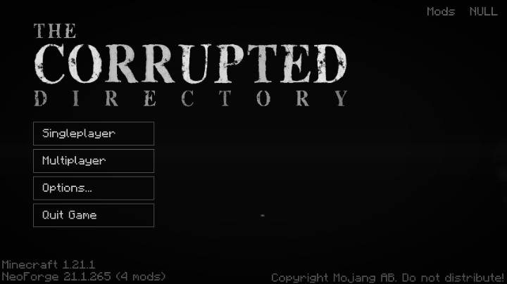
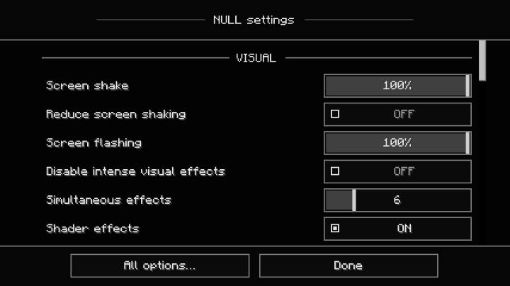
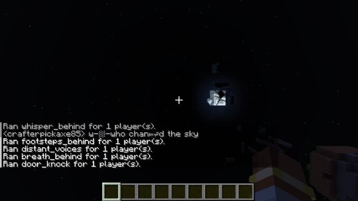
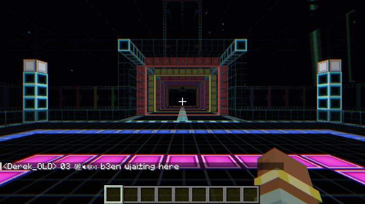
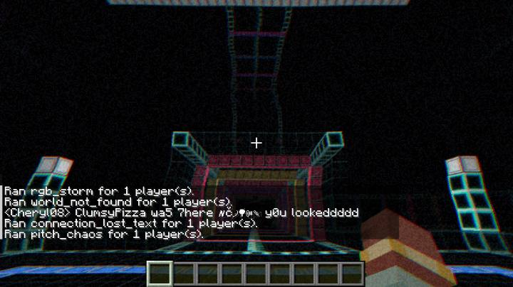
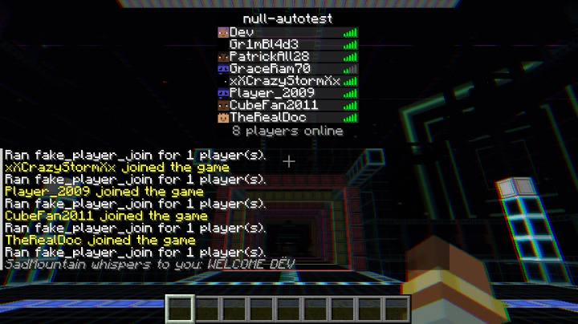

# NULL — The World Is Failing

A psychological-horror mod for **Minecraft 1.21.1** on **NeoForge** (21.1.x, Java 21).

NULL never explains itself. From the moment a world loads, Minecraft starts to come apart:
first a black block where a stone should be, a flicker in the sky, static too quiet to be
sure of. Night after night the moon cracks and shatters, black parasites grow out of corrupted
ground, players who are not players watch from the tree line, and finally the world is gone
and something else is running in its place.

There are no weapons, armour, ores, quests, bosses or progress bars. The only goal of the mod
is to make it feel like the game itself is failing.

---

## Installing

1. Install NeoForge for Minecraft 1.21.1.
2. Put `null-<version>.jar` in your `mods/` folder — on the client, and on the server for
   multiplayer (both sides need it). A player with NULL installed can still join servers that
   do not have it; nothing happens there.
3. Start a world. NULL begins immediately.

A ready-built jar is in [`dist/`](dist/). GitHub Actions also builds one on every push
(**Actions → Build NULL mod → Artifacts → `null-mod-jar`**).

The Mods list shows NULL twice: **NULL** and **NULL (module)**. That is expected. The mod id is
`null`, which Java does not accept as a module name, so the jar carries a small technical
second entry whose id names the module. It has no content of its own.

## The six stages

Stages 1-5 advance with in-game nights, counted from when NULL began in the world: a night has
passed when dawn comes, and sleeping through it counts. NULL only counts while someone is
online, never moves a stage backwards on its own, and saves everything with the world. Stage 6
begins when a player survives five minutes in the NULL dimension.

| Stage | Begins | What happens |
|---|---|---|
| 1 · STATIC | immediately | Something is wrong. Black and missing-texture blocks, blocks that blink out, wrong textures on trees, brief chunk flicker, a sky that flickers for a frame, static and footsteps you can't place. Thin black figures watch from behind trees and through your windows, doors creak open at night, and something digs towards you in the mines. |
| 2 · FRACTURE | after 3 nights | Reality is breaking. Camera shakes, screen distortion, freezes and blackouts, the sky changes colour, outdated-looking terrain fragments and floating islands appear, the moon starts to crack. Mobs start to turn corrupted. |
| 3 · INFESTATION | after 6 nights | NULLROOT: black parasitic plants grow out of corrupted ground, walls and cave ceilings. Some only watch. Some reach for you. Parasites: black tentacles grow out of mobs. |
| 4 · VISITATION | after 10 nights | The Visitors: player-shaped things with old usernames that stand and stare, follow, or appear behind you. Bedrock hangs in the sky; abandoned villages, wrong buildings and corridors to nowhere appear. Music turns warped and wrong. |
| 5 · NULL | after 15 nights | The world stops. Everything goes quiet and dark, and you wake up in NULL — an endless glowing geometric structure. The player list fills with players who are not there, and chat no longer makes sense. Survive there for five minutes. |
| 6 · HARVEST | after surviving 5 minutes in NULL | Everything goes black and you wake in an endless wheat field under a huge, still sun. Through the day the sun cracks; then it shatters, night falls and a countdown appears: TIME UNTIL "IT" COMES. IT is six blocks tall and far faster than you, and only a house hides you. Survive and dawn comes and the sun re-forms; die and you wake in the field again. |

Different regions of a world corrupt at different speeds. Operators can change the pace with
`/null pace` or in the world's config. Random events come about once a minute per player in
Stage 1 and every ten seconds in NULL; raising `/null speed` makes them come more often too (up
to six times as often).

**Corrupted and parasite mobs.** From Stage 2 any mob, vanilla or modded, can turn corrupted: a
damaged copy of its own texture, stuttering, freezing to stare at you, the wrong sounds. From
Stage 3 mobs can become parasite hosts with black tentacles growing out of them. They keep their
normal health, damage and loot; peaceful mobs never attack. Villagers, traders, golems, bosses,
tamed or named animals and NULL's own creatures are never changed.

**Seeing everything.** NULL is subtle on purpose. An operator can run `/null showcase`: NULL
pauses and takes you through the six stages one by one, every event of each stage happening in
front of you and named on your action bar. Afterwards your position and the world's stage,
speed and time are put back.

## Settings (per player)

Open **Mods → NULL → Config**, or the small **NULL** link on the corrupted main menu.

- **Visual:** screen shake strength, *Reduce screen shaking*, screen flashing strength (at 0,
  flashes become slow fades), *Disable intense visual effects*, number of simultaneous
  effects, shader effects.
- **Audio:** horror sounds on/off, audio corruption strength, and separate switches for
  static, whispers, phantom footsteps, wrong pitches and sudden silence. NULL's music cannot be
  switched off in game; only the game's master volume changes how loud it is. From Stage 4 on,
  every piece of music turns warped and wrong.
- **Menus:** NULL's corrupted title screen (with its faces in the dark), its look on every other
  menu and the writing in blood on the inventory can be switched off together to get the vanilla
  look back; animation and glitch strength; menu sounds.
- **Desktop interference** (on by default, see below).

All settings are saved in `config/null-client.toml`.

### Desktop interference

NULL shows small black "error" windows on your desktop, outside the game window. It is **on by
default** and can be switched off at any time in NULL's settings (every open window closes at once). Every window is labelled as
coming from the NULL Minecraft mod, can be closed by clicking it or pressing Esc, closes on its
own, never takes keyboard or mouse focus, never imitates real system or security dialogs, and
never appears after Minecraft has closed. NULL does not change anything on your computer and
collects nothing. It is unavailable on macOS and on systems without a desktop, and is never
used on dedicated servers.

Once it is on, the settings screen controls how often windows appear ("Never" stops them
all), the shortest pause between two windows (45 s by default) and a separate chance for each
kind of window: small corner notifications (A), error windows (B), distorted messages (C),
larger NULL reports (D) and the Stage 5 final interference (E). **Show test message** shows one window right away. Stage 1
has almost none; they become more frequent and stranger with every stage.

## Server / world configuration

Each world has `serverconfig/null-server.toml` (copy one into `defaultconfigs/` to change the
defaults for new worlds). Everything is adjustable: how many nights each stage takes and the progression speed, the survival time in NULL, the field's day, countdown and hunt, IT's speed, corrupted and parasite mobs (`[mobs]`), event
frequency and intensity, Visitor / NULLROOT / chat frequency, simulated player count, moon
speed, world corruption intensity, upper limits for client screen shake / audio / effect
counts, and whether the final transition happens automatically.

**World safety:** NULL never destroys player builds. It remembers every chunk where a player
has placed blocks and scans for built-looking blocks before changing anything, and it only
ever replaces natural terrain or places blocks into air. `allowWorldModification = false`
makes all corruption purely visual; `replaceNaturalBlocks = false` keeps natural terrain
untouched while still allowing structures in the air. Leaves you placed, waterlogged blocks
and light blocks always count as built. The NULL dimension is separate: the
original world is never deleted.

## Commands (operators)

| Command | |
|---|---|
| `/null status` | stage and progress, night count and nights until the next stage, survival times in NULL, the field's day and night, speed, moon |
| `/null stage <1-6>` | jump to the start of a stage (forwards or backwards); `6` takes everyone into the field |
| `/null pace` | after how many nights each stage begins, and the survival time in NULL |
| `/null pace <2-5> <nights>` | when a stage begins (later stages move along to keep the order) |
| `/null pace 6 <minutes>` | how long a player has to survive in NULL for HARVEST |
| `/null pace reset` | back to 3 / 6 / 10 / 15 nights and 5 minutes |
| `/null field <day\|cracking\|shatter\|night\|hunt\|dawn>` | Stage 6: jump the field's shared day and night |
| `/null showcase` | a guided tour through all six stages; `stage <1-6>`, `next`, `stop`, `<seconds>` per step |
| `/null mob <corrupted\|parasite\|clear> [targets]` | turn the mob you look at (or the targets) corrupted, into a parasite host, or back to normal |
| `/null reset` | back to Stage 1 (run twice to confirm) |
| `/null pause` / `/null resume` | stop / continue progression and random events |
| `/null speed <multiplier>` | speed up or slow down progression |
| `/null events` | list all random events by stage |
| `/null event <id> [players]` | run one random event now |

## Building from source

```bash
cd null-mod
./gradlew build
```

The jar ends up in `null-mod/build/libs/`. `./gradlew runGameTestServer` runs the GameTests;
`./gradlew runClient` starts a development client.

## How it is tested

Every push runs the **Build NULL mod** workflow (`.github/workflows/build-null-mod.yml`):

1. **Compile and package** the jar.
2. **GameTests** on a GameTest server: stage progression, persistence and commands, the
   random event registry, build protection, world corruption, the moon, Visitors, NULLROOT
   growth, capture and release, corrupted chat and the NULL geometry function.
3. **Client smoke test**: a scripted client on a virtual display opens the corrupted main menu
   and NULL's settings, creates a world, goes through every stage with every random event
   forced, watches the moon, is taken into the NULL dimension, opens the player list, returns
   to the overworld and quits, taking screenshots on the way. Its integrated server also runs
   the NULL dimension self-check (generated chunks, arrival platform, decay and exact
   regeneration).
4. **Multiplayer smoke test**: a real NeoForge dedicated server with the built jar, joined by
   the scripted client: stage sync, every stage, the NULL transition over the network and the
   simulated player list. The server must not load a single client class and must pass the
   dimension self-check.

Screenshots from these runs (software rendering on a virtual display, so the overworld looks
plainer than on a real GPU; the "Ran … for 1 player(s)" lines are the test forcing events):

| | |
|---|---|
|  |  |
| The corrupted main menu | NULL's settings |
|  |  |
| Stage 4: the moon breaking apart | Stage 5: the NULL dimension |
|  |  |
| Distortion and corrupted chat in NULL | Players who are not there |
